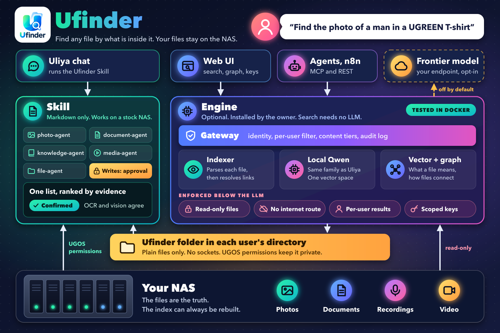
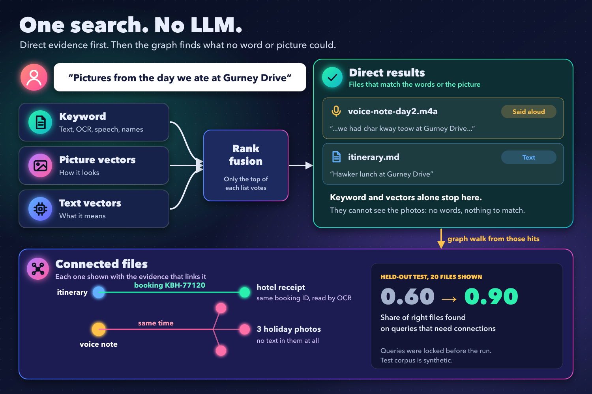
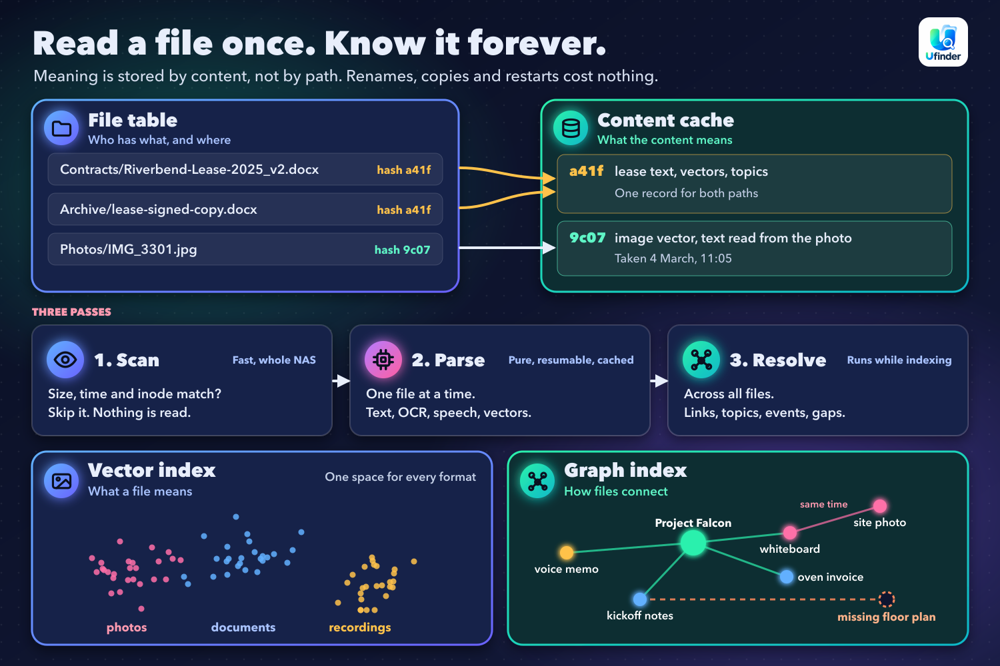
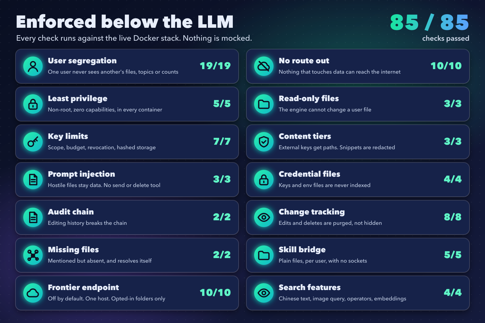

<p align="center">
  
</p>

<h1 align="center">Ufinder</h1>

<p align="center"><b>Find any file by what is inside it. Private, local, and fast enough that search needs no LLM.</b></p>

<p align="center">
A vector and graph index for a NAS, with a Skill for UGREEN Uliya and an open door for any agent.
</p>

> Independent project for the UGREEN Hackathon 2026. Not an official UGREEN product. Tested in Docker on a laptop. It has not yet run on a UGREEN NAS.

---

## The bottleneck in AI is data, not the model

Every NAS maker is racing to put a bigger LLM in the box. That is the wrong race.

A smarter model reading the wrong file gives you a smarter wrong answer. A model that cannot find the file gives you nothing. [Gartner](https://www.gartner.com/en/newsroom/press-releases/2025-02-26-lack-of-ai-ready-data-puts-ai-projects-at-risk) expects 60% of AI projects without AI-ready data to be abandoned through 2026, and 63% of organizations are not confident they manage data the way AI needs.

On a NAS, the problem is concrete:

- **File search is blind.** People remember what is in a file, not what it is called. Search looks at names and stored text. A photo, a scanned receipt and a voice memo have neither.
- **Every file type is a different problem.** A photo needs vision. A scan needs OCR. A recording needs speech recognition. A video needs all three. Each ends up in its own app, with its own index.
- **Agents pay for every look.** With no shared index, an agent opens files one at a time, and every step needs an LLM. A hundred thousand files cannot go through a chat loop.

Ufinder fixes this at the bottom of the stack. It reads every file once, in the background, on the NAS. It stores what each file means and how files connect. Then search is a lookup, not an inference.



## Results

Measured on an Apple M2 Max through Linux containers. Full method and raw numbers are in [docs/RESULTS.md](docs/RESULTS.md).

| What | Result |
|---|---|
| Keyword search at 200,000 files | **6.6 ms** |
| Keyword, vector and graph lookup at 200,000 files | **21 ms** |
| Graph walk at 1 million links | **73 ms**, touching 140 nodes |
| Find the right files, 49 locked held-out queries | **0.90** recall@10 |
| Keyword alone, same queries | 0.47 |
| Vector alone, same queries | 0.84 |
| Queries that need connections, without and with the graph | **0.60 to 0.90** |
| Public COCO benchmark, 1,000 images, 1-bit vectors | **95.1%** recall@10 |
| Security and system checks on the live stack | **85 of 85** pass |
| New file searchable by content | **2.1 s** |
| Rename, with nothing read or embedded | **0.7 s** |
| LLM calls on the search path | **0** |
| Bytes leaving the NAS during search | **0** |

The lookup figures are before query embedding. A full text search takes about 0.67 s on CPU, nearly all of it embedding the query. Scale figures use generated records through the real engines. Quality figures come from a small test set that we built, so read them as a demonstration, not a benchmark.

## Eight things we learned

**1. Retrieval is the real AI bottleneck.** Once the index exists, finding a file costs milliseconds and no tokens. The LLM's job shrinks to understanding the request and reading the few files that matter.

**2. Files have two kinds of meaning.** Vectors know what a file is like. A graph knows what a file belongs to. A hotel receipt looks nothing like a beach photo, unless you know they came from the same trip. "Photos taken right after the whiteboard session" went from 0% to 100% with the graph, because only time connects them.

**3. Do not let a graph vote like evidence.** Our first design blended the graph into the ranking, and recall fell from 0.88 to 0.62. A walk starts from the hits, so it is not independent evidence. Direct results now stay untouched, and connected files are their own list, each with the reason it is there.

**4. Store meaning by content, not by path.** One table says who has what, and where. Another says what that content means, keyed by hash. So a rename changes one row, a duplicate reuses a record, and a restart after a crash re-read nothing: 457 unchanged files were skipped.

**5. Privacy cannot live in a prompt.** A Skill can ask a model to behave. It cannot block a network. Real guardrails sit underneath: read-only mounts, a sealed network, a filter before every retriever, and keys that can never exceed their owner.

**6. A slow first pass is fine on a machine that never sleeps.** Our pipeline takes about 4.7 seconds per image on 6 CPU cores. That would be painful on a laptop. A NAS runs 24/7, so that is roughly 18,000 images a day in the background, once. After that, only new files cost anything, and every search for the rest of the NAS's life is instant.

**7. Measure what you assume.** The "lightweight" model needs 9.5 GB of RAM. The model card's `bfloat16` default ran 7× slower on CPU. 8-bit quantization looked like the fix, then proved slower, larger, and damaging to the vectors. Only testing showed that.

**8. Scale bugs hide at small sizes.** One wrong query plan cost 7 seconds per search at 200,000 files, and was invisible at 464. Fixing it made search about 1,100× faster, with no change to the ranking.

## How search works



1. Parse operators by rule: `type:photo`, `path:Bakery`, `after:2025-01-01`.
2. Run keyword search on names, text, OCR and speech.
3. Run vector search. Pictures and text vote separately, so one word match cannot fill the results.
4. Fuse the lists with reciprocal rank fusion.
5. Walk the graph from the top hits with personalized PageRank.
6. Return direct results with evidence, then connected files with the link that found them.



The graph is built from evidence, not typed by anyone: identical content, versions, files named in text or speech, shared projects and IDs, and capture time. If a note mentions a file that is not on the NAS, Ufinder records a ghost node, tells you what is missing, and links it by itself when the file arrives.

## Two parts

| | Skill | Engine |
|---|---|---|
| **Is** | Markdown that orchestrates UGOS experts | A local service with a vector and graph index |
| **Runs** | Inside Uliya, on demand | In the background, always |
| **Needs** | A stock UGREEN AI NAS | Docker, about 14 GB of free RAM |
| **LLM** | Uliya's model for each step | None for search |
| **Scale** | Hundreds of files per request | 200,000 records tested |

They share only plain files in each user's own folder. No sockets. The Skill works with nothing else installed. Skills cannot run code, start services or call local APIs, so the engine is installed separately by the owner.

### The Skill: 16 functions

| Find | Understand | Organize |
|---|---|---|
| **Find** by description | **Brief**: answers with citations | **Albums** from verified photos |
| **Relate** connected files | **Expenses**: receipts into totals | **Duplicates** report and plan |
| **Moments**: one timeline for a trip | **Contracts**: dates and notice periods | **Tidy** with approval |
| **Dossier**: everything on a project | **Recordings** into notes | **Map** linked graph notes |
| **Missing**: mentioned but absent | **Digest**: what changed | **Tag** and **Status** |
| | **Events**: camera events with same-time files | |

Built on 36 delegated steps across all six UGOS expert agents. Passes the official checker with 0 errors and 0 warnings. See [submission/ufinder](submission/ufinder/SKILL.md).

To check it, get `uliya-skill-kit` from the [UGREEN starter kit](https://ai.ugreen.com/pages/hackathon-starter-kit). It is not included here.

## Run the engine

```sh
git clone git@github.com:ZYLIM0702/Ufinder.git
cd Ufinder/engine

# List your folders, users, and who may read what.
# Change the sample passwords first.
$EDITOR config/ufinder.json

sh install.sh --sources /path/to/folders --users /path/to/user-homes
sh doctor.sh
```

Open `http://localhost:8787` and sign in. Search works straight away and improves as indexing runs. Containers restart on their own after a reboot.

| Script | Does |
|---|---|
| `install.sh` | Checks the machine, fetches pinned weights once, starts the stack |
| `doctor.sh` | Read-only health check, including the no-internet and read-only rules |
| `uninstall.sh` | Stops the stack. `--purge` also deletes the index. Your files are never touched |

More in [engine/README.md](engine/README.md).

## Connect your agent

Create a key in the Web UI, then:

```text
MCP     http://NAS-IP:8787/mcp     Authorization: Bearer YOUR_KEY
REST    POST /v1/search            {"q": "lease renewal"}
Graph   GET  /v1/files/{id}/related
Changes GET  /v1/changes?since=0
Spec    GET  /openapi.json
```

MCP is tested with the official SDK, protocol `2025-11-25`. Tools: `search_files`, `get_file`, `get_related`, `list_changes`, `read_snippet`, `propose_organization`. No tool can send, delete or write. Organizing returns a plan for a person to approve.

**Bring your own model.** The local default is Qwen3-VL-Embedding-2B, from the same family as Uliya. Any OpenAI-compatible endpoint can serve folders you choose, or other tools can use the NAS model through `/v1/embeddings`. External access is off by default, allows one host, and sends a search query only when a signed-in person asks.

## Privacy, tested



| Guardrail | How it works |
|---|---|
| Read-only | Sources mount read-only. The gateway has no access to user files |
| No route out | Everything that touches data sits on a sealed network |
| One forwarder | The only published port belongs to a process with no data and no keys |
| User segregation | One filter before every retriever. Graph walks skip hidden files |
| Scoped keys | Folder, tool, content tier, expiry and daily budget |
| Content tiers | External keys see paths by default. Snippets are redacted |
| Audit chain | Each row hashes the last, so editing history shows |

These checks caught real bugs along the way, including a topic name leaking across users and search queries reaching an external API. The full list is in [the project story](submission/about-the-project.md).

## Where it sits

Most AI NAS products add a bigger brain. Ufinder builds the memory.

| | Search reach | Needs | Agent access |
|---|---|---|---|
| File name and text search | Names and stored text | Nothing | None |
| Synology AI Search | Drive documents | GPU model | Vendor assistant |
| QNAP Qsirch AI Mode | Cross-media | Discrete GPU, 16 GB VRAM | Built-in RAG |
| Immich | Photos and videos | CPU or GPU | Its own API |
| **Ufinder** | **Photos, documents, speech, video, plus a graph** | **CPU, 14 GB RAM** | **MCP, REST, Skill** |

Research and sources are in [docs/MARKET.md](docs/MARKET.md).

## Known limits

- Not yet tested on a UGREEN NAS. Speed on the iDX6011 Pro is unknown.
- The model needs about 9 GB of RAM on CPU, so it does not fit 8 GB NAS models yet.
- A first index on CPU takes days for a large library.
- Quality numbers come from a small corpus that we built.
- The scale test used generated records, and skipped the model.
- The graph's resolve pass rebuilds in full, so it must become incremental for millions of files.
- Compose mode uses plain HTTP on the LAN.
- n8n has the API it needs, but is not yet tested end to end.

## Roadmap

| Stage | Form | Gets you |
|---|---|---|
| Now | Skill plus Docker | Everything here |
| Next | UGOS Docker APP | App Center install, auto-start, system login |
| Then | UGOS Native APP | Its own user, and no internet unless it asks |
| Goal | Part of UGOS | Indexing from the day the NAS is set up |

## Repo map

```text
engine/       the service: search, graph, gateway, Web UI, tests
submission/   the Skill package, proposal, project story, visuals
docs/         design, results, research, market
assets/       logo
```

## Credits

Built with SQLite, Qdrant, Qwen3-VL-Embedding-2B, faster-whisper, RapidOCR, FFmpeg and FastAPI. Test photos come from COCO val2017, with faces blurred, and are not distributed here. Licenses are listed in [the disclosures](submission/ufinder/references/disclosures.md).
