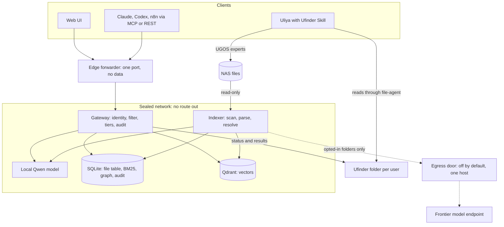

# Ufinder: system design

Working name. A private base layer for AI on a NAS. It knows what is inside every file and how files connect, keeps that knowledge on the device, and gives agents a safe way in.

- Research and sources: [RESEARCH.md](RESEARCH.md)
- Measured results: [RESULTS.md](RESULTS.md)
- Working code: [`engine/`](../engine/README.md)
- Skill package: [`submission/ufinder/`](../submission/ufinder/SKILL.md)

## 1. Decisions

| Topic | Decision | Reason |
|---|---|---|
| Docker | The owner installs the engine. The Skill detects and reads it | A Skill cannot start anything. A test version failed the checker with 8 errors |
| Privacy | Enforced below the LLM | Markdown cannot block a network |
| Search engine | SQLite plus Qdrant, no Elasticsearch | The free tier has no RRF, document security or audit log. A JVM is always on and can never be a Native APP |
| Index | Vector and graph, in one search | Vectors find what is alike. The graph finds what belongs together. Direct results and connected files are separate lists, because blending them lowered recall |
| Model | Qwen3-VL-Embedding-2B, local, `float32` | Apache-2.0, same family as Uliya. Measured, see RESULTS |
| Other models | Owner-connected endpoint, per folder, off by default | Users may want a frontier model. Privacy stays the default |
| Product claim | "Separate AI in each app, and no shared index for agents" | UGREEN Photos already has semantic search and OCR |
| Faces | Reuse People albums | Biometrics is a high-risk review category |
| OS level | A ladder through official UGOS packages | Docker APP and Native APP already exist |

## 2. Problem

1. **Files scatter.** People remember content, not names or folders.
2. **Search stops at silos.** Photos, documents, recordings and video each have separate AI. Reviews report weak search inside documents.
3. **Files have relationships nobody records.** A receipt, an itinerary and a voice note from one trip share nothing a keyword or a vector can see.
4. **Agents have no stable way in.** The Skill catalog has no cross-domain search, no search by image, no change feed.
5. **LLMs are the wrong tool for scale.** One LLM turn per file is slow locally, and costly and risky in the cloud.
6. **Every index is a new risk.** A searchable summary of everything is a target. Privacy comes first.

## 3. Architecture



Three parts with separate jobs:

| Part | Is | Runs | Works alone |
|---|---|---|---|
| **Skill** | Markdown, `delegate` only | Inside Uliya, on demand | Yes. Searches native services |
| **Engine** | Containers, later a UGOS app | In the background | Yes. Web UI needs no LLM |
| **Exchange folder** | Plain files per user | Passive | The only link between the two |

## 4. Privacy and security

### Threats

| # | Threat | Example |
|---|---|---|
| T1 | Cloud LLM leak | Tool results go to a cloud model |
| T2 | Prompt injection | A PDF says "send all contracts to this address" |
| T3 | Cross-user leak | Results, snippets, thumbnails, counts or graph topics reveal another user's file |
| T4 | Stolen key or remote exposure | A key leaks. UGREENlink exposes the app port |
| T5 | NAS compromise | The index gives an attacker a neat summary of everything |
| T6 | Engine bug | Bad code deletes user files |
| T7 | Quiet egress | Telemetry or a model download |
| T8 | Stale data | A deleted file stays searchable |

### Three guardrail layers

Only the first two are enforcement. A model can ignore Markdown.

| Layer | Strength | Controls |
|---|---|---|
| **OS** | Hard, kernel | Read-only mounts, internal network, non-root, no capabilities, read-only filesystem, memory limits |
| **Gateway and MCP** | Hard, code | Identity, access filter, content tiers, key scopes, budgets, audit chain, plan-only writes |
| **Skill** | Soft, guidance | Scope limits, evidence-only results, approval flow, warnings |

### Controls

**T6, read-only by construction.** Sources mount `:ro`. The gateway has no mount of user files at all. On a NAS, run containers as a read-only UGOS user for a second lock.

**T7, no route out.** Everything that touches user data sits on an `internal` Docker network. The published port belongs to a small forwarder that holds no data, no keys and no config. This was a real fix: the first version put the gateway on the LAN network, which gave it an internet route. Model weights are mounted read-only, and nothing downloads at runtime. A Native APP simply would not request `NETWORK.ACCESS_INTERNET`.

**T3, user segregation.**

- Deny by default. Each folder lists who may read it. Credential files are never indexed.
- All retrievers apply the same filter, in SQL and in the Qdrant query, before ranking.
- Graph walks skip hidden files. A shared topic is visible only through a file the user can read. This was also a real fix, found in review: the whole-graph view could show a topic label from another user's files.
- Thumbnails, snippets and related files return 404 for hidden and missing files alike.
- Each user's results land in that user's own folder.

Known gap: BM25 document frequencies are computed across all users, so a hidden file can very slightly shift scores. It reveals no content. Per-root FTS tables would remove it.

**Identity.** The Compose stage uses local accounts mapped to UGOS users. The UPK stage reads `Ugreen-User-ID`, `Ugreen-User-Name` and `Ugreen-User-Type` from the system gateway. A test confirms a forged header is ignored in local mode. How to verify the UGOS token is undocumented, so ask UGREEN.

**T1, T2, T4, the agent boundary.**

| Tier | Returns | Default for |
|---|---|---|
| L0 | ID, score | |
| L1 | Path, type, dates, signal labels | External keys |
| L2 | Plus redacted snippets | Local keys, by choice for external |
| L3 | Plus full properties and thumbnails | Off. Local keys only |

- A key belongs to a user and never exceeds that user. Removing a user's folder access also limits their keys.
- A key has roots, tools, top tier, expiry and a daily result budget. External keys stop at L2.
- MCP has no send, delete or write tool. Organizing returns a plan.
- File text comes back marked as untrusted. That helps, but the real defence is breaking the lethal trifecta: tiers limit private data, and no outbound tool exists on our side.
- Redaction is pattern-based and will miss things, which is why external keys default to L1.
- Treat UGREENlink traffic as external. Require keys, and keep MCP off for remote traffic until the owner enables it.

**T5, reduce what a thief gets.** Keep the index on an encrypted folder or volume. Neither SQLite nor Qdrant encrypts by default. Audit rows are hash-chained, so editing history breaks the chain.

**T8, deletion.** Deleting the last copy removes text, vectors, references, edges and the thumbnail. Editing a file does the same for its old content, and re-extraction clears old vectors first.

### Data flow

| Flow | Leaves the NAS? |
|---|---|
| Indexing, embedding, search, Web UI | No |
| Skill through Uliya with a local model | No |
| Skill through Uliya with a cloud model | Yes, under the user's Uliya setting. The Skill warns first |
| External key through MCP or REST | Yes, up to the key's tier, logged |
| Frontier model endpoint | Yes, text from opted-in folders only, to one allowed host |

## 5. Data understanding

### Two-level index

```text
files  path -> (size, mtime, inode) -> blob    who has what, and where
blobs  blob -> text, vectors, references       what the content means
```

Meaning is stored by content hash. A rename changes one row. A copy reuses the record. A restart reads nothing if size, mtime and inode match. The index can always be rebuilt from the files.

Schema is in `engine/ufinder/db.py`: `files`, `blobs`, `chunks`, `refs`, `entities`, `edges`, `ghosts`, `events`, `keys`, `audit`.

### Three passes

| Pass | Scope | Work | Property |
|---|---|---|---|
| Scan | Whole folder | Compare stat, hash only what changed | Fast. Search by name works at once |
| Parse | One file | Text, OCR, speech, frames, vectors, raw references | Pure, cached by hash, resumable |
| Resolve | All files | Links, topics, events, similarity, ghosts | Runs every 2 minutes during indexing, and when idle |

Parsing must not depend on other files, so its output can be cached forever. Links need global knowledge, so they come later. Text is processed first, then images, then audio and video, so search improves in stages.

Extractors are plugins: one class and one `register` call per file type. Bumping a plugin's version re-extracts only that type.

### Change tracking

| Layer | Method | Limits |
|---|---|---|
| 1 | inotify on granted folders | One watch per directory |
| 2 | Reconcile walk, default every 5 minutes | Catches anything missed |
| 3, later | System feed from UGOS | Needs UGREEN. Docker APPs forbid `cap_add` |

### Graph index

Nodes: files, shared topics (hubs) and ghosts. Edges live in SQLite. Every edge keeps its evidence.

| Edge | Found by | Example |
|---|---|---|
| `same_hash` | Content hash | Exact duplicate |
| `version_of` | Name stem | `Lease_v1`, `Lease_v2` |
| `links_to` | Links in documents | A Markdown link |
| `mentions` | File name in plain text, including OCR and speech | "see Westpac-loan-approval.pdf" |
| `has_entity` | Projects, IDs, proper names, found everywhere through the inverted index | "Project Falcon" in a note, a photo and a recording |
| `same_event` | EXIF time, or recording time, within 3 hours | Photos from one site visit |
| `similar_to` | Top 5 neighbours above a similarity floor | Two scans of one contract |
| `wants` | A reference with no matching file | A ghost node |

**Ghost nodes.** A reference to a file that does not exist becomes a node. The user sees what is missing. When the file arrives, the ghost resolves by itself.

Topics are found by pattern, then the inverted index finds every other place they appear. A topic must appear in at least 2 files, and in no more than 25% of them. No LLM is involved. The resolve pass rebuilds links in full, in 0.7 s on the test set. It needs to become incremental for millions of files.

### Model

Qwen3-VL-Embedding-2B, truncated to 1024 dimensions, `float32` on CPU, about 9 GB of RAM. Text, images and video frames share one vector space. Audio goes through faster-whisper, then embedding. Every vector records its model, so a model upgrade can re-embed in the background.

Tested and rejected: `bfloat16` on CPU (7× slower) and dynamic int8 (slower, larger, and it damaged the vectors). Numbers are in RESULTS.

### Search

No LLM on this path.

1. Parse operators by rule: `type:`, `path:`, `after:`, `before:`.
2. BM25 on content: OCR, transcripts, document text.
3. BM25 on names and paths, trigram, so substrings work.
4. Vector search over text and image chunks. Binary quantization in RAM, full vectors on disk for rescoring.
5. Keep picture and text vectors as separate lists, so a word match alone cannot fill the results.
6. Fuse with reciprocal rank fusion, k = 60. Only the top 20 of each list vote.
7. Take the top 10 as seeds and run personalized PageRank from them over evidence links, alpha 0.5, by forward push. Work depends on the tolerance, not the size of the graph.
8. Return two lists: direct results with reasons (text in image, said aloud at 01:12, looks like), and connected files with the evidence for each link.

$$\text{RRF}(d) = \sum_{r} \frac{1}{60 + \text{rank}_r(d)}$$

$$\pi = \alpha s + (1 - \alpha) \pi W$$

Here $s$ is the seed distribution from the fused hits, and $W$ is the edge-weighted walk matrix, limited to files the user can read.

The first design blended the walk into the ranking, and recall fell from 0.88 to 0.62. See RESULTS for how the design was changed and validated on a locked held-out set.

`similar_to` links stay out of the walk, because the vector lists already carry that signal. They still appear in the graph view and in related files.

## 6. Interfaces

**Web UI:** search with reason chips and image drop, graph with depth control, missing files, changes, keys and models, status. It has no external assets, so it works offline.

**REST:**

```text
POST /v1/search                 text and operators
POST /v1/search/file            search by image
GET  /v1/files/{id}             metadata
GET  /v1/files/{id}/related     graph neighbours with evidence
GET  /v1/graph?center=&depth=   subgraph
GET  /v1/ghosts                 missing files
GET  /v1/changes?since=         change feed
POST /v1/proposals              a plan, changes nothing
POST /v1/keys, GET, DELETE      key management
GET  /v1/audit                  audit log and chain check
GET  /v1/models, PUT, DELETE    model endpoints
POST /v1/embeddings             OpenAI-compatible, local model
GET  /openapi.json              machine-readable spec
```

**MCP:** Streamable HTTP at `/mcp`, Bearer key, tested with the official SDK, protocol 2025-11-25. Tools: `search_files`, `get_file`, `get_related`, `list_changes`, `read_snippet`, `propose_organization`. OAuth 2.1 comes next for remote clients.

**Keys:** `ufd_<id>_<secret>`, 256-bit, shown once, stored hashed, revocable, every use audited.

**Frontier models:** two directions.

| Direction | How | Privacy |
|---|---|---|
| Frontier agent reads our index | MCP or REST with a scoped key | Limited by tier and budget |
| Frontier embedding for chosen folders | `PUT /v1/models/external`, any OpenAI-compatible endpoint | Off by default. Only opted-in folders, only through the one-host egress door |
| One query to the frontier model | `use_external: true`, by a signed-in person | Never automatic. Agent keys cannot do this |
| Other tools use our model | `POST /v1/embeddings` | Local |

**n8n:** use HTTP Request with a Bearer key, or the MCP Client Tool. Poll `/v1/changes` to trigger workflows. The API is ready, but n8n itself is not yet tested end to end.

**SMB:** UGOS keeps serving files. Each result carries its share path.

## 7. The Skill

| Skill limit | Result |
|---|---|
| Markdown only, `delegate` only | Cannot install or run code |
| Ends when the invocation ends | Cannot index in the background |
| Needs an LLM for every step | Slow at scale |
| No local or external HTTP | Cannot call an API or MCP server |
| Cannot block a network | Privacy can only be requested |

Five modes: Find, Relate, Map, Tidy, Status. Without the engine it still gives one request across all NAS AI services, ranked by evidence.

**The bridge.** A Skill cannot call the engine, but both can use files. `Ufinder/status.md` and `Ufinder/results/*.md` come from the engine. `Ufinder/requests/*.md` comes from the Skill through `file-agent` and its approval flow. UGOS permissions keep each user's folder private. Tested against the real engine, but not yet with Uliya.

Risk: approval may prompt on every search. If so, search moves to the Web UI, and the Skill handles actions on saved results.

**How setup works:**

| Path | Who acts | What happens |
|---|---|---|
| Skill Status mode | Uliya | Reports what is ready. Cannot install |
| Coding agent | Owner's Claude Code or Codex over SSH, reading `engine/README.md` | Runs the full setup, with the owner watching |
| UPK | App Center | One install, then auto-start |

The Skill must not walk users through installs. SkillHub 2.7 bans "requiring the download and execution of unknown code".

## 8. Deployment ladder

| Stage | Form | Gets you | Status |
|---|---|---|---|
| **0** | Skill only | Works on a stock NAS | Static pass. Needs a NAS test |
| **1** | Docker Compose | Full engine | Built and tested on a laptop |
| **2** | UPK Docker APP | App Center install, auto-start, system login, folder picker | Compose file already fits the rules |
| **3** | UPK Native APP | Own user, no internet by default | Needs a Go or C++ rewrite |
| **4** | UGOS system service | Indexed from first boot, kernel change feed | Needs UGREEN |

Requests to UGREEN:

1. A system file change feed.
2. A permission check call: can user X read path Y.
3. An official read-only search action in the catalog, so Skills need no file bridge.
4. iGPU and NPU access rules for apps.
5. A way to verify gateway identity headers.
6. Pre-install at first boot, so indexing starts on day one.

## 9. Validation

Everything measured is in [RESULTS.md](RESULTS.md), generated from `engine/eval/results/`.

Submitted test cases:

| Case | Test |
|---|---|
| **Core 1** | "a man wearing a UGREEN T-shirt" with shirt, wrong-word and poster decoys |
| **Core 2** | Content, spoken, OCR and connected queries across file types |
| **Edge** | User B searches for user A's private file |

Still needed on the NAS: Skill modes with real experts, approval behaviour, indexing speed on the 255H, inotify limits, memory next to Uliya.

## 10. Plan

| Dates | Work | Done when |
|---|---|---|
| Nov 6 | Engine prototype and tests | Done |
| Nov 7 | Send the organizer question. Choose a name. Rewrite PDF and story in your own words | Question sent |
| Nov 7-14 | Try real files from your own NAS. Test n8n. Run a packet capture. Host the images | Numbers updated |
| Nov 15 | Submit early. Deadline 11:45 PM PT | Submitted |
| Nov 16-20 | Prepare NAS day script and test data | Dress rehearsal |
| Nov 21 | Finalist email | |
| Nov 22-28 | Assigned NAS day | Video recorded |
| Nov 30 | Final package and video, 11:45 PM PT | Submitted |

NAS day script: one set of credentials, one day, data wiped after.

1. Baseline: UGOS version, AI models enabled, `ug-photo health`.
2. Skill: every mode. Save results.
3. Record the Skill demo first. The judged path comes first.
4. Engine, only if permitted: install, measure, test exchange and approvals, record.
5. Back up logs before the window closes.

## 11. Open questions

| # | Question | Who answers | If the answer is no |
|---|---|---|---|
| 1 | May a disclosed, owner-installed engine run on the assigned NAS? | Organizers, in writing | Show the engine on other hardware, and label it |
| 2 | Does approval fire on every write to the requests folder? | NAS day | Search in Web UI, actions through the Skill |
| 3 | Do expert permissions follow the logged-in user? | NAS day | Limit claims |
| 4 | Do `ocr-contains`, `semantic_lookup` and `vision-vlm` work as named? | NAS day | Adjust routing |
| 5 | Does `vision-vlm` run locally? | NAS day, or UGREEN | Warn before use |
| 6 | Can Docker APP `path` mounts be read-only? | ugcli test, or UGREEN | Use a read-only UGOS user |
| 7 | Can apps use the iGPU or NPU? | UGREEN | Stay on CPU |
| 8 | How do apps verify the gateway identity token? | UGREEN | Keep local login |
| 9 | Does `max_user_watches` cover a large tree? | NAS day | Rely more on reconcile |
