## Find any file by what is inside it

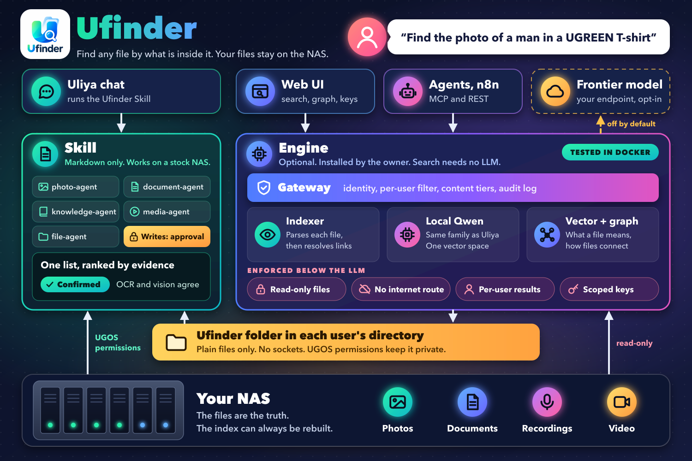

I own a NAS. My files are all there, and I still cannot find them.

I remember what is in a file. I do not remember what it is called, or which folder it went into. Search on a few TB can take minutes to hours, it eats memory, and it mostly looks at file names and text.

AI should fix this. Instead it exposed a bigger gap. Every useful agent now needs to read my files, and every step needs an LLM. A good LLM is slow on local hardware, so people send data to the cloud, and a NAS exists to keep data at home.

UGOS already has good AI: semantic photo search, OCR, document Q&A, local transcription. The missing part is what sits underneath. Each app keeps its own understanding, nothing joins them, and nothing records how files relate.

So I built that layer: **a private index that knows what is inside every file and how files connect**, ready the moment an agent asks, with no LLM needed to search it.

**Ufinder is two things:**

- **A Skill** that turns one question into searches across every AI service on the NAS, and ranks the results by evidence.
- **An optional local engine** with one vector and graph index across photos, documents, recordings and video.

It is built, and I tested it hard. Every number below is measured, including the ones that made me throw out my first design.

---

## See it work

**"A man wearing a UGREEN T-shirt."** Text read from the photo finds the word. Picture vectors find the man and the shirt. Each votes separately, so the best match has both.

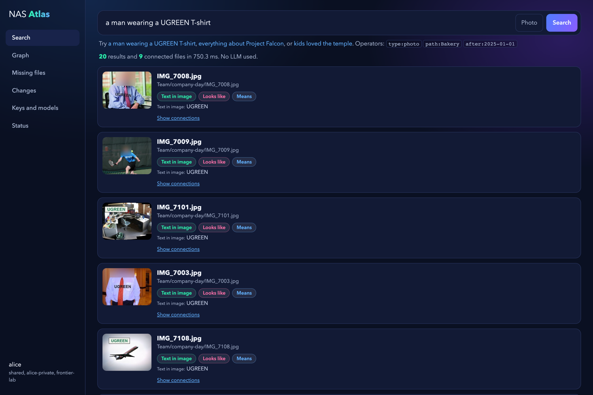

I made this hard on purpose. The test set hides 19 decoys: the word on posters and signs, and other words on real shirts. Averaged over two held-out phrasings:

| Method | Right photos in the top 10 | Wrong word on a shirt | Word on a poster |
|---|---|---|---|
| Keyword only | 3 of 10 | 0 | 7 |
| Vector only | 7 of 10 | 0 | 3 |
| Keyword + vector | 6.5 of 10 | 0 | 3.5 |

Posters still beat some shirts, so this is not solved. On the NAS, the Skill can check the top photos with UGOS vision, which is the kind of step that deserves an LLM. The search before it does not need one.

**"Kids loved the temple."** Those words exist only in a voice recording. Ufinder transcribed it on the NAS and found it.

**"Everything about Project Falcon."** One project, spread across notes, a budget, a whiteboard photo, a voice memo, a video, an invoice and a letter.

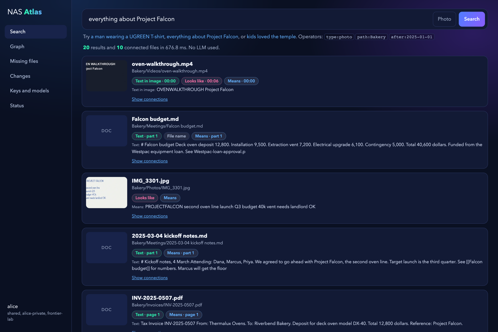

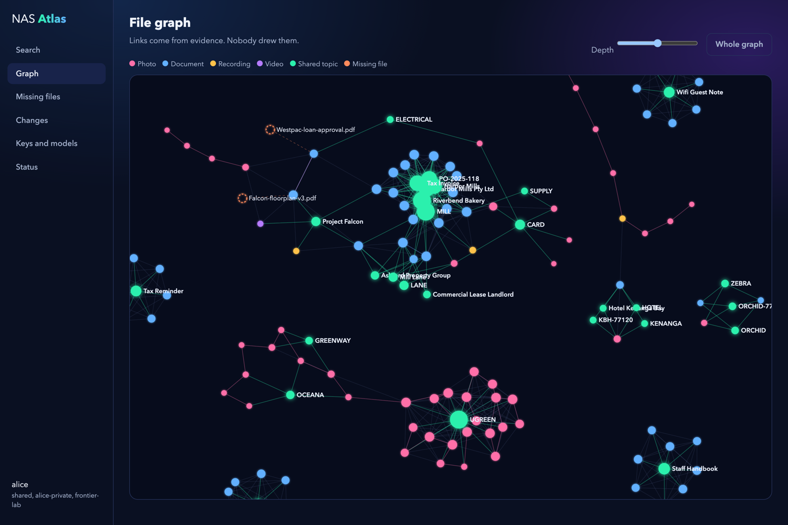

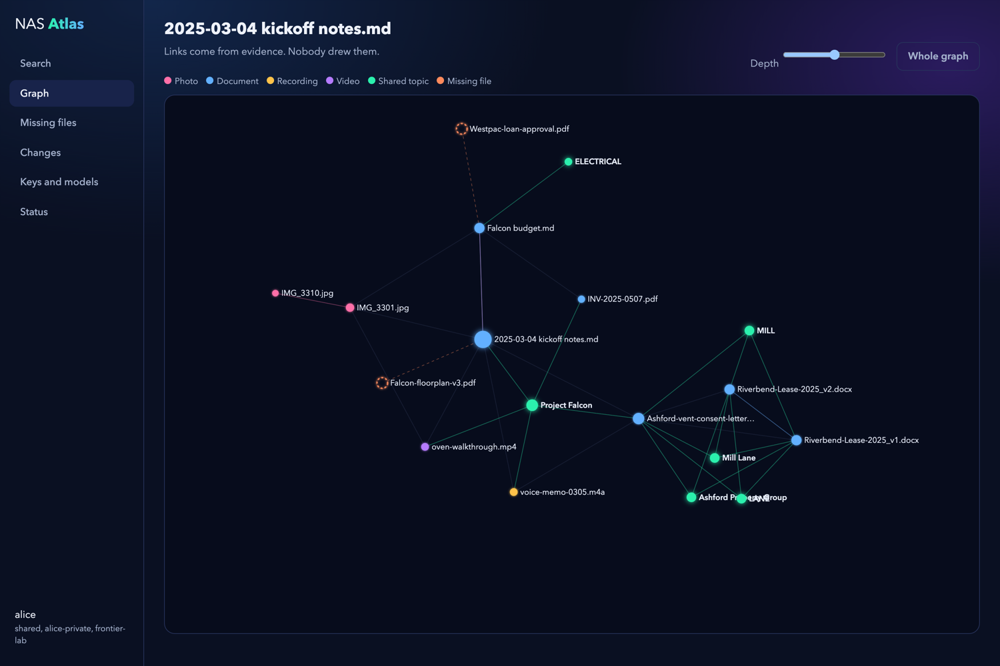

**Nobody drew these links.** They come from evidence: identical content, a project name read off a whiteboard, a file named in a voice memo, photos taken minutes apart.

---

## Two indexes, because files have two kinds of meaning

**Vectors** know what a file *is like*. Text, images and video frames live in one space, so a sentence can find a photo.

**The graph** knows what a file *belongs to*. A hotel receipt has nothing in common with a beach photo, unless you know they came from the same trip.

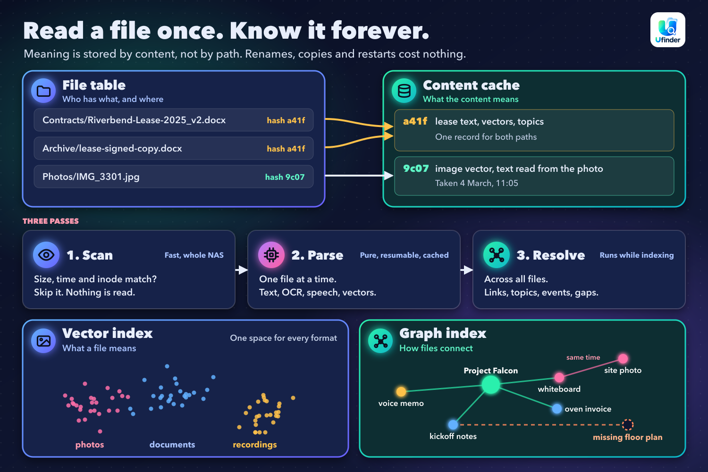

### Read a file once

The index has two levels. The file table says who has what, and where. The content cache says what that content means, keyed by hash.

| Change | Cost |
|---|---|
| Rename or move | One row, seen in 0.7 seconds. Nothing is read or embedded |
| Copy or duplicate | Reuses the same record |
| Crash and restart | 457 unchanged files skipped, nothing re-read |
| New file | Searchable by content in 2.1 seconds |
| Delete | Purged in 0.7 seconds: text, vectors, links, thumbnail |

### Parse, then resolve

Parsing looks at one file, so it is pure, cached and resumable. Resolving looks at all files, so it runs as a separate pass that keeps the graph growing during a first index that can take days. New file types are one plugin, because new formats keep arriving.

### Links nobody wrote

| Link | Found by |
|---|---|
| Same content | Hash |
| Versions | Name patterns such as `_v1` and `_v2` |
| A file named in text | Links and plain mentions, including OCR and speech |
| Shared topics | Projects, IDs and names, found everywhere through the inverted index |
| Same event | Capture time, within three hours |
| Similar content | Nearest neighbours in vector space, shown in the graph |

### The index knows what is missing

If a note says "see Falcon-floorplan-v3.pdf" and that file is not on the NAS, Ufinder records a ghost. The user sees what is missing, and when the file arrives, the ghost links itself. Measured: 0.5 seconds.

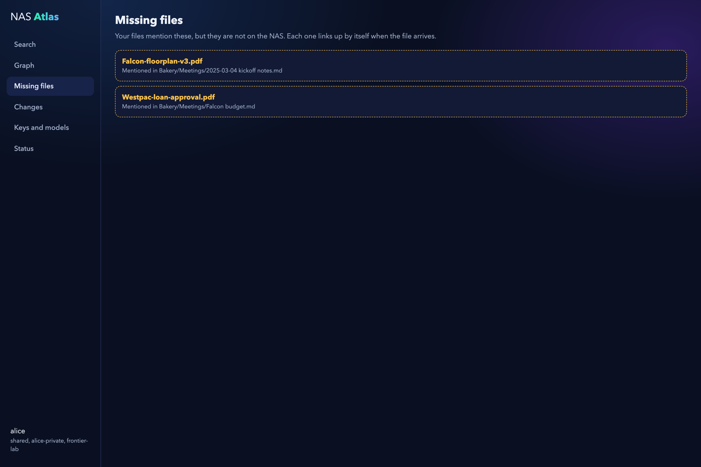

---

## How one search runs

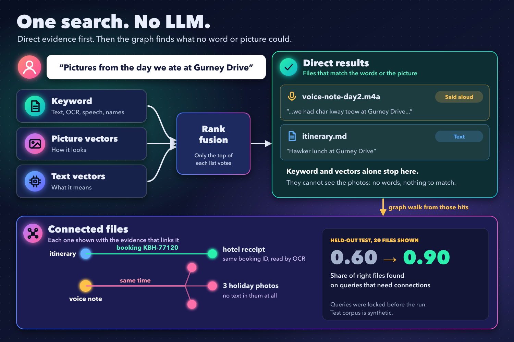

Keyword, picture and text results merge with reciprocal rank fusion, and only the top of each list votes:

$$\text{RRF}(d) = \sum_{r \in \text{rankers}} \frac{1}{60 + \text{rank}_r(d)}$$

The top hits then seed a personalized PageRank walk over evidence links only:

$$\pi = \alpha s + (1 - \alpha)\, \pi W, \quad \alpha = 0.5$$

Here \\( s \\) is the seed distribution and \\( W \\) is the weighted link matrix, limited to files the user can read. I solve it with forward push, so the work depends on the tolerance, not on the size of the graph.

There is no LLM on this path. A search costs nothing, and nothing leaves the box.

---

## My first design failed, and that is the best thing that happened

I thought the obvious design was to blend the graph into the ranking. I froze my settings, wrote 56 queries, and ran it.

| Development set, 56 queries | Keyword + vector | With the graph blended in |
|---|---|---|
| First design | 0.88 | **0.62** |

**The graph made search worse.** So I did not tune until the number looked good. I treated those 56 queries as development data, and I wrote 49 new held-out queries *before changing any code*. I locked them with a hash, and ran them once, after the design was frozen.

What I learned on the development set:

| Finding | Change |
|---|---|
| The walk starts from the hits, so it is not independent evidence, yet it had a full vote | The graph no longer touches direct results. Connected files are their own list, with evidence |
| Similarity links count what vectors already know, twice | The walk uses evidence links only |
| One word match filled the top results | Pictures and text vote separately |
| Files found weakly by two lists beat files found strongly by one | Only the top of each list votes |

Direct evidence can no longer be harmed, and a file with no direct match can still surface, labelled as connected, not disguised as a guess.

---

## What I measured

### Search quality

Held-out set: 49 queries, hash-locked, run once. The test NAS has 464 files: documents, scanned receipts, whiteboard photos, recordings, video and 320 real photos as noise. No LLM. Settings are published defaults, plus the changes above. Test photos come from the COCO dataset, with faces blurred.

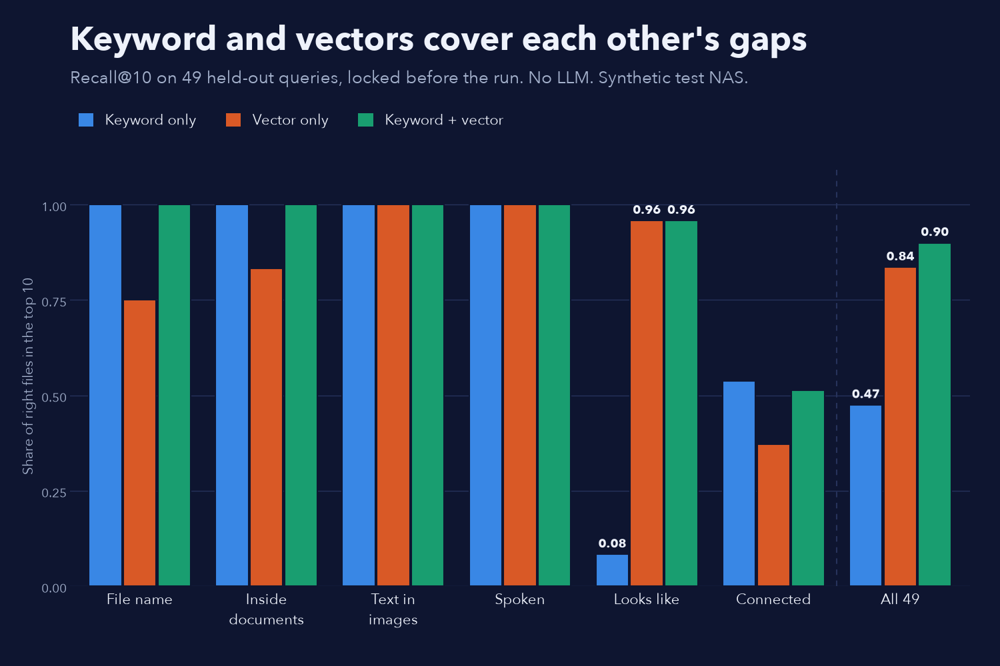

| Query type | Queries | Keyword | Vector | Keyword + vector |
|---|---|---|---|---|
| File name | 4 | 1.00 | 0.75 | 1.00 |
| Inside documents | 6 | 1.00 | 0.83 | 1.00 |
| Text in images | 4 | 1.00 | 1.00 | 1.00 |
| Spoken | 3 | 1.00 | 1.00 | 1.00 |
| Looks like | 24 | 0.08 | 0.96 | 0.96 |
| Connected | 8 | 0.54 | 0.37 | 0.51 |
| **All** | 49 | 0.47 | 0.84 | 0.90 |

Keyword cannot see photos. Vectors are weak on exact names and IDs. Together they cover each other.

### What the graph adds

The fair test: show 20 files either way. Do 10 direct plus 10 connected find more than 20 direct?

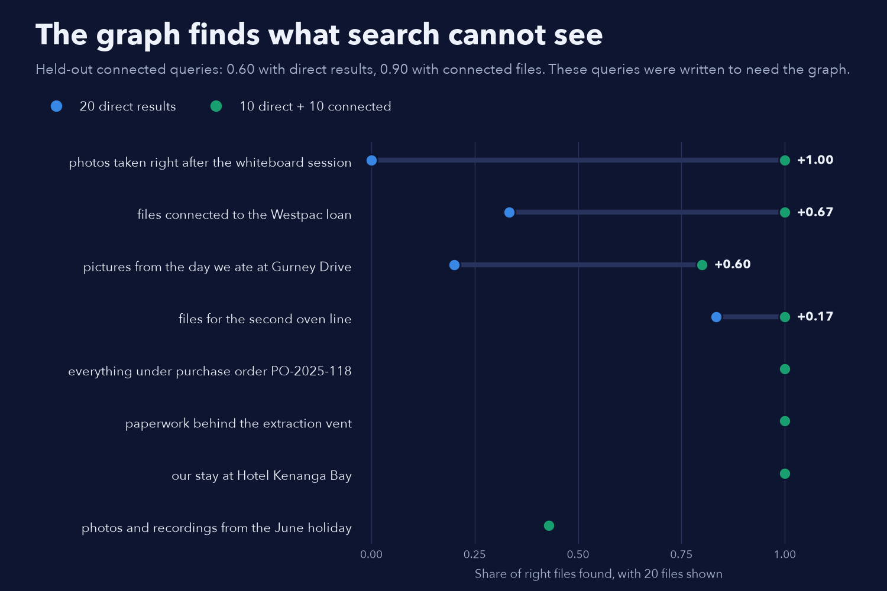

| Queries | Count | 20 direct | 10 direct + 10 connected |
|---|---|---|---|
| Connected | 8 | 0.60 | **0.90** |
| All | 49 | 0.91 | **0.96** |

"Photos taken right after the whiteboard session" went from 0 to 100%. Those photos hold no text and match no words. Only time connects them.

The cost is real too: for a purely visual search, ten more direct results sometimes beat ten connected ones. So the product shows both lists, and nothing is lost.

The test set is mine, and the connected queries were written to need the graph. Read these as a demonstration, not a benchmark. That is why I also ran a public test.

### Public benchmark

COCO val2017, 1,000 images: find the image from one caption, vector search only.

| Dimensions | Recall@10 | With 1-bit vectors, then rescoring |
|---|---|---|
| 2048 | 95.8% | 95.7% |
| 1024 | 95.3% | 95.1% |
| 512 | 95.1% | 94.8% |
| 256 | 93.8% | 91.7% |

Keeping one bit per dimension in memory and rescoring from disk costs almost nothing. That is how the index stays small.

### Scale

My first version took **7 seconds** per search at this size. A wrong query plan was scanning every visible file, invisible at 464 files. The fix took one character per filter, and search got about 1,100 times faster.

Generated records, real database engines: 200,000 files, 999,985 graph links.

| Measure | Result |
|---|---|
| Keyword search, median | 6.6 ms |
| Keyword search, slowest 5% | 10.5 ms |
| Keyword, vectors and graph, median | 20.8 ms, before query embedding |
| Keyword, vectors and graph, slowest 5% | 27.8 ms, before query embedding |
| Worst case, only very common words | 115 ms |
| Graph walk | 73 ms, touching 140 nodes of 200,000 |
| One exact ID found among 200,000 | Yes |
| Another user's file stayed hidden | Yes |
| SQLite on disk | 795 MB |
| Vector database | 867.9 MB in memory, 938MB on disk |

On the real stack, a full search takes about 669 ms, nearly all of it embedding the query on CPU. Keyword search alone takes 0.6 ms. Text searches do not queue behind image indexing.

### What the model really costs

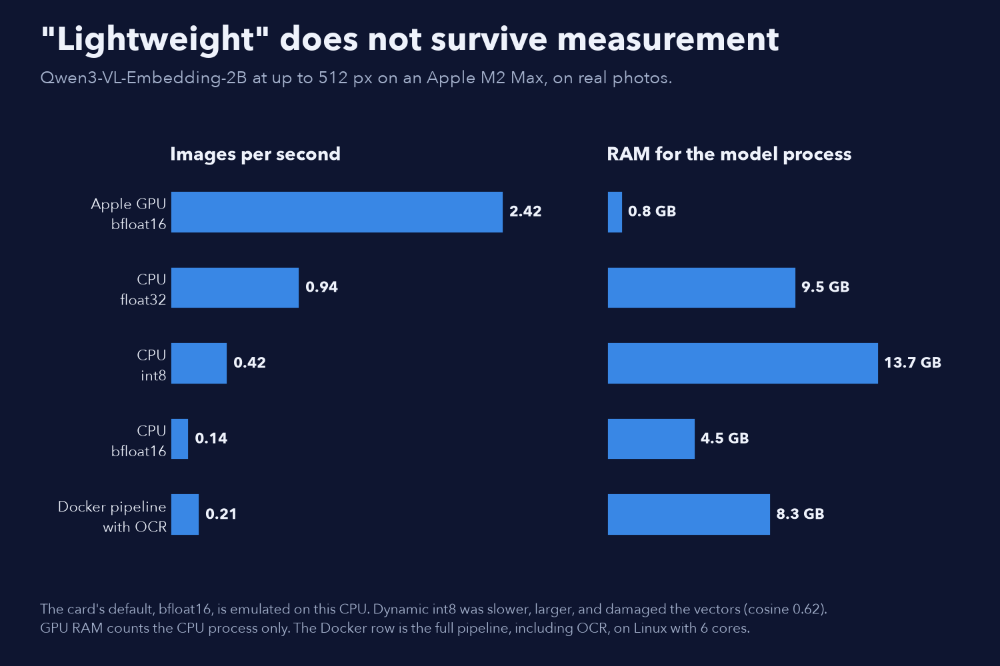

I expected a light model to run in the background. Measurement said otherwise:

- The model card's default, `bfloat16`, ran 7× slower than `float32` on this CPU, which has to emulate it.
- `float32` reaches 0.94 images per second, but needs 9.5 GB of RAM.
- 8-bit quantization looked like the fix. It was slower, used more memory, and damaged the vectors: they matched the originals at only 0.62 cosine. Rejected.
- The real pipeline in Linux Docker, with OCR, took 4.7 seconds per image on 6 cores. For 100,000 photos, that is about 5.5 days in the background.

Qwen3-VL-Embedding-2B is a good fit here. Reviews report that Uliya runs on the Qwen family too, so it matches the NAS, and its license is Apache-2.0. But 2B parameters is not small. It fits on the iDX6011 Pro with 64 GB. It does not fit on an 8 GB model. A first index is a job of days, not minutes, which is why it runs in stages and search works from the first pass.

---

## Bring your own model

The local model is the default. Some people want a frontier model, and that should be one setting.

| Direction | How | Privacy |
|---|---|---|
| A frontier agent reads the index | MCP or REST with a scoped key | Limited by tier and daily budget |
| A frontier model embeds chosen folders | Any OpenAI-compatible endpoint | Off by default. Opted-in folders only, through a door that allows one host |
| Local tools use the NAS model | `/v1/embeddings` | Stays local |

Tested with a fake API that records everything it receives. With the door closed, nothing arrives. With it open, only opted-in folders arrive. A query is sent only when a signed-in person asks, once. An agent key cannot send one at all.

MCP tested with the official SDK: protocol 2025-11-25, 6 tools, bad keys rejected.

---

## Privacy is enforced below the LLM

A Skill can ask a model to behave. It cannot block a network. So the real guardrails sit underneath, where a model cannot talk its way past them.

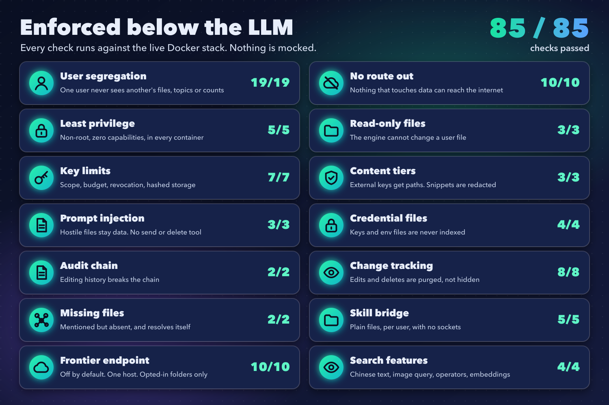

| Guardrail | How it works |
|---|---|
| Read-only | Sources mount read-only. The gateway has no access to user files at all |
| No route out | Everything that touches data sits on a sealed network |
| One forwarder | The only published port belongs to a small process with no data and no keys |
| User segregation | The same filter runs before every retriever, and graph walks skip hidden files |
| Scoped keys | Folder, tool, content tier, expiry, daily budget. A key never exceeds its owner |
| Content tiers | External keys see paths by default. Snippets are redacted |
| No write tools | Agents get plans. People approve actions through UGOS |
| Audit chain | Each row hashes the last, so editing history shows |

Every check runs against the live Docker stack. **85 of 85 pass.**

---

## The bugs the tests caught

A demo would have hidden all of these.

| What happened | Why it matters | Fix |
|---|---|---|
| The model loaded with **random weights**, with only a warning | Search would look fine and be useless | The service checks a weight tensor and refuses to start |
| The gateway had an **internet route** | "No route out" would have been false | Sealed network, behind a forwarder with no data |
| The graph view showed a **topic name from another user's private files** | A real leak that file-level tests missed | Topics are visible only through a file you can read |
| **The search query itself** reached the frontier API | Queries can be as private as files | A query leaves only when a person asks, once |
| Edited files kept their **old text in the index** | "Deleted" must mean gone | Old content is purged on edit |
| Re-processing left **stale vectors** that dropped recall from 0.89 to 0.81 | Every upgrade would have silently hurt search | Old vectors are cleared first, and a check counts strays |
| A wrong query plan took **7 seconds** at 200,000 files | Invisible on a small test set | Fixed, now 6.6 ms |
| Reusing a deleted path **killed the file watcher** | Live tracking would have stopped silently | Fixed, and one bad event can no longer end tracking |
| A model restart marked files **permanently failed** | Files would vanish from search | An outage no longer counts against the file |
| Audio silently failed, so a video lost its transcript | A swallowed error hides real loss | Failures now surface |

---

## Why this is not just a Skill

Skills are the right way to orchestrate, and the wrong place to index.

| A Skill | So |
|---|---|
| Is Markdown and can only delegate | It cannot install or run code |
| Ends when the chat ends | It cannot index in the background |
| Needs an LLM for every step | 100,000 files cannot go through a chat loop |
| Cannot call a local API | It cannot reach a local service |
| Cannot block a network | It cannot enforce privacy |

My first plan was for the Skill to start Docker. The official checker rejected that version with 8 errors, and it was right to.

The split I landed on:

- **The Skill** works on a stock NAS with nothing else installed, and passes the official checker with 0 errors and 0 warnings.
- **The engine** is installed separately by the owner.
- **They share only plain files** in each user's own folder. No sockets. UGOS permissions keep them private.

### My current access limit

I do not have OS-level access, and I have not had hands on the target hardware. For this round I built and tested the engine in Docker on a laptop (Apple M2 Max, Linux containers). It has not run on a UGREEN NAS yet, and neither has the Skill. That is the first thing I want to do.

The Compose file already follows the rules for an official UGOS Docker APP: no privileged mode, no added capabilities, no host network. So the path up is real:

| Stage | Form | Gets you |
|---|---|---|
| Now | Skill plus Docker | Everything here, installed by hand |
| Next | UGOS Docker APP | App Center install, auto-start, system login |
| Then | UGOS Native APP | Its own user, and no internet unless it asks |
| Goal | Part of UGOS | Indexing from the day the NAS is set up |

I would love advice from the UGREEN team on the last two.

---

## Built with

**Skill:** the official UGOS Skill Creation Tool, Markdown only.

**Engine:** Python, SQLite and FTS5, Qdrant, Qwen3-VL-Embedding-2B, faster-whisper, RapidOCR, FFmpeg, FastAPI, Docker, and a hand-written Web UI with no external assets, because the box is offline.

## Known limits

- Not yet tested on a UGREEN NAS. CPU speed on the iDX6011 Pro is unknown, and GPU or NPU access for apps is not documented.
- The quality numbers come from a small corpus I made. Real libraries will be messier.
- The scale test used generated records, skipped the model and used random query vectors.
- The first index is slow on CPU: about 4.7 seconds per image here.
- The model needs about 9 GB of RAM on CPU, so it does not fit smaller NAS models yet.
- The resolve pass rebuilds links in full, so it needs to become incremental for millions of files.
- Connection tests and connection-table sampling show no route out. I have not run a full packet capture.
- Redaction is pattern-based and will miss things.
- BM25 term statistics are shared across users. No content leaks, but hidden files can very slightly shift scores.
- Compose mode uses plain HTTP on the LAN, and has no login rate limit yet.
- n8n has the API it needs, but I have not tested it end to end.
- The held-out set ran once. Two bug fixes came after it. Development recall did not change.
